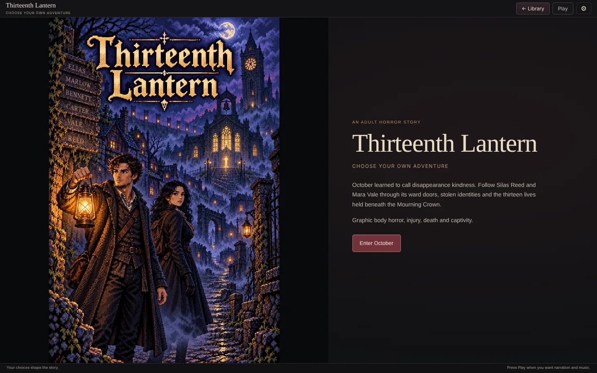
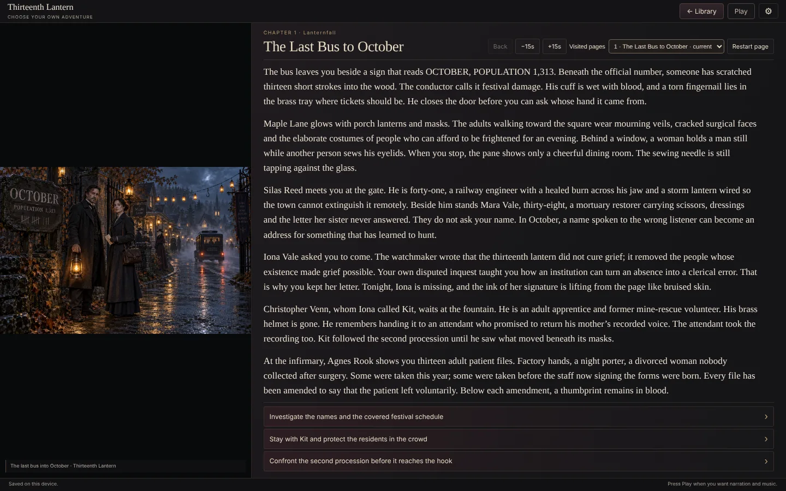
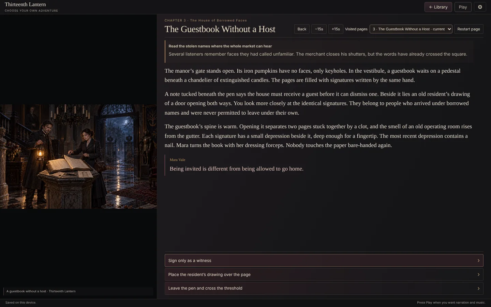
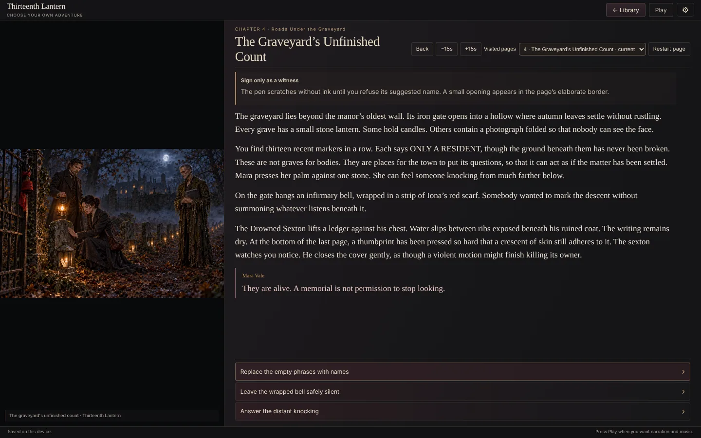
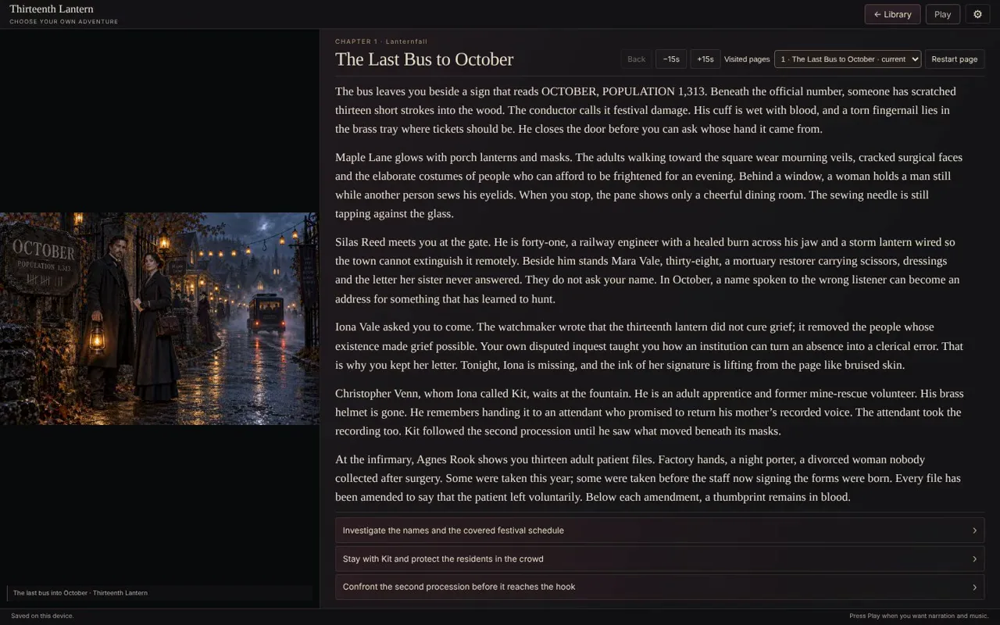

# Thirteenth Lantern

**A town that calls disappearance kindness. 601 routes lead to twelve endings.**

[**▶ Live demo**](https://beebopcat.github.io/thirteenth-lantern/) · [**Play on caseyshingledecker.com**](https://caseyshingledecker.com/demos/top-secret/thirteenth-lantern/) · [**Source**](https://github.com/Beebopcat/thirteenth-lantern)

[](https://beebopcat.github.io/thirteenth-lantern/)

> **Status:** the game files are being added to this repository. Until `index.html` is at the repository root, the GitHub Pages link above has nothing to show; the same game is playable on caseyshingledecker.com.

## What it is

An adult horror choose-your-own-adventure. Silas Reed and Mara Vale enter October, a town that calls disappearance kindness; 601 routes lead to twelve substantial endings.

## Screenshots

| | |
|:--:|:--:|
|  |  |
| <sub>Thirteenth Lantern cover with a painted pair of figures holding a lantern and an Enter October button.</sub> | <sub>Story reader on chapter The Last Bus to October, with a lantern-lit illustration, several paragraphs and three choices.</sub> |
|  |  |
| <sub>Story reader on chapter The Guestbook Without a Host, with a book-and-candle illustration and three choices.</sub> | <sub>Story reader on chapter The Graveyard's Unfinished Count, with a lantern-lit graveyard illustration and three choices.</sub> |

### Video

[](docs/media/clip.mp4)

*Click the poster to open the short screen recording (docs/media/clip.mp4).*

## How to use

1. Choose Enter October, or Continue a saved journey.
2. Choose a route through rooms, records and encounters by picking one of the choices on each page.
3. Use Back to return to the previous choice.
4. Use Visited pages, Current journey and Restart page to see where you have been; narration offers -15s and +15s where it has been recorded.
5. Switch Music and Voice on or off. Narration plays only where it has been recorded and verified.

### Quick start


<sub>Story reader on chapter The Last Bus to October, with a lantern-lit illustration, several paragraphs and three choices.</sub>

## Features

- 601 routes and twelve endings
- Illustrated pages
- Music and Voice toggles
- Visited pages and a current-journey view

## The story behind it

Ward doors, stolen identities and thirteen lives under the Mourning Crown.

## Built with

- HTML and JavaScript

## Run it locally

This is a static web project, so any local web server works:

```bash
git clone https://github.com/Beebopcat/thirteenth-lantern.git
cd thirteenth-lantern
python -m http.server 8000
```

Then open http://localhost:8000 in your browser.

## Content notes

This is a work of dark fantasy and horror for adult readers. Content note: graphic body horror, injury, death and captivity. Adult readers only.

## Credits & disclaimers

Built by Casey Shingledecker with AI-assisted development.

## More projects

- Portfolio and live demos: https://caseyshingledecker.com/
- All repositories: https://github.com/Beebopcat

## License

Copyright (c) 2026 Casey Shingledecker. All rights reserved. Source-available for viewing and for personal, non-commercial running only; this is not open source. See [LICENSE](LICENSE). See also [NOTICE.md](NOTICE.md). Other people's material keeps its own license.
